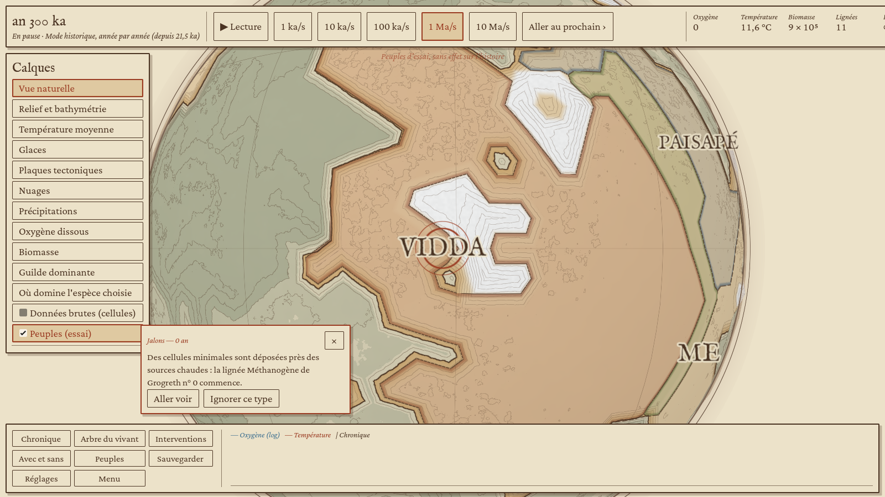
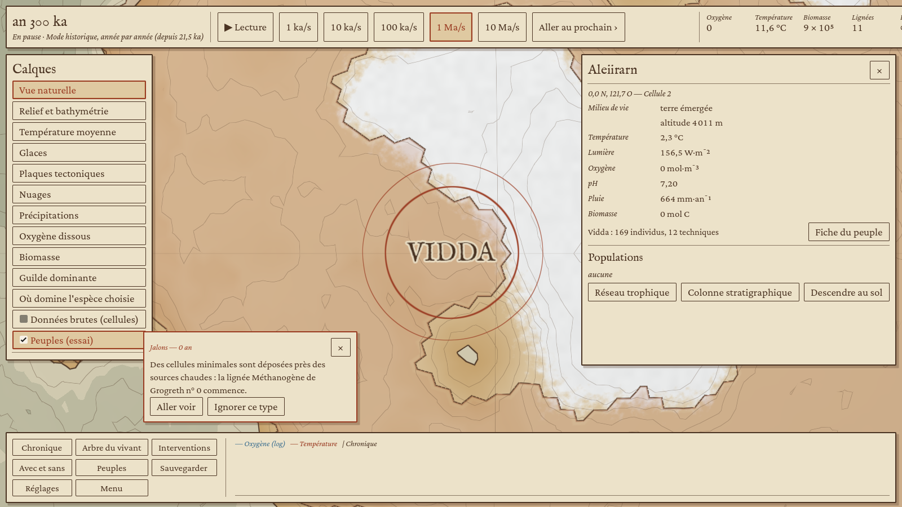
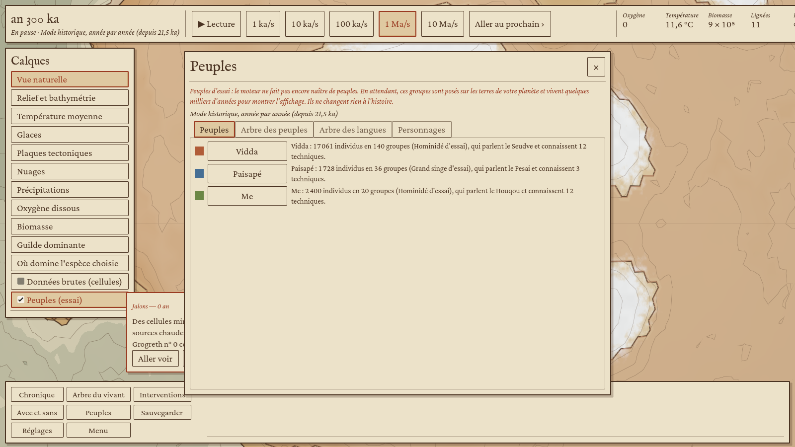
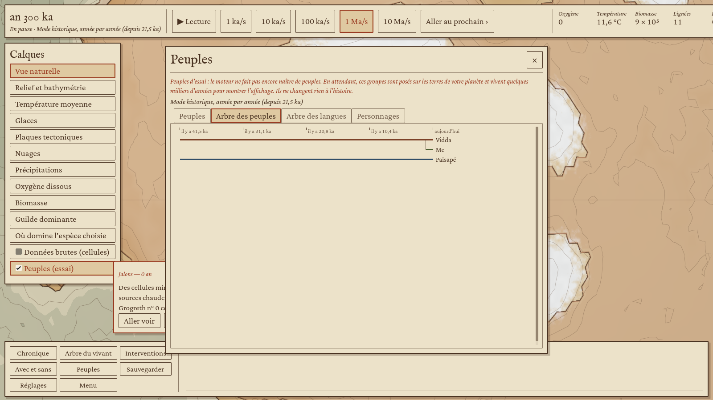
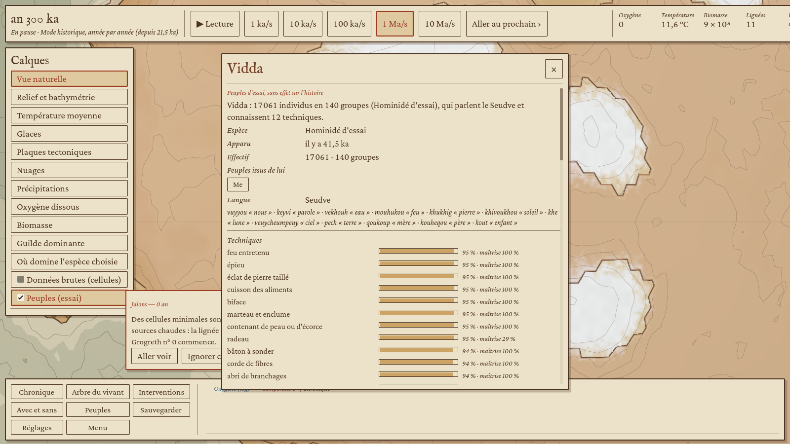
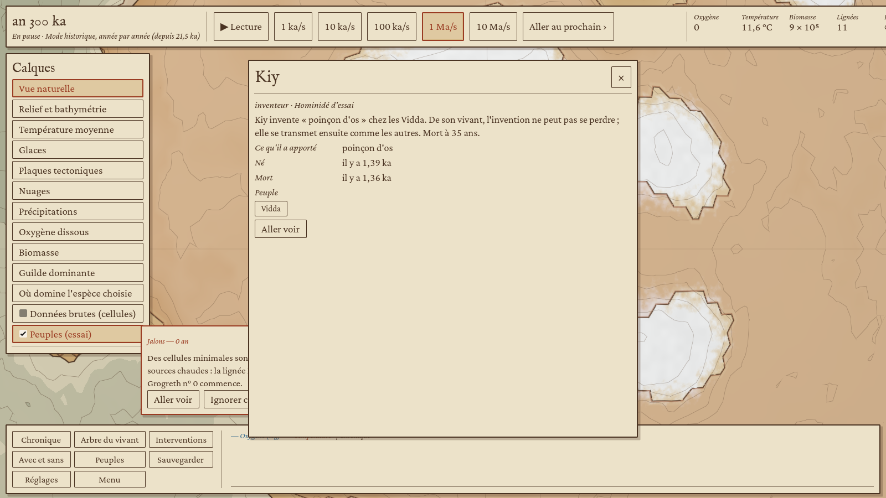
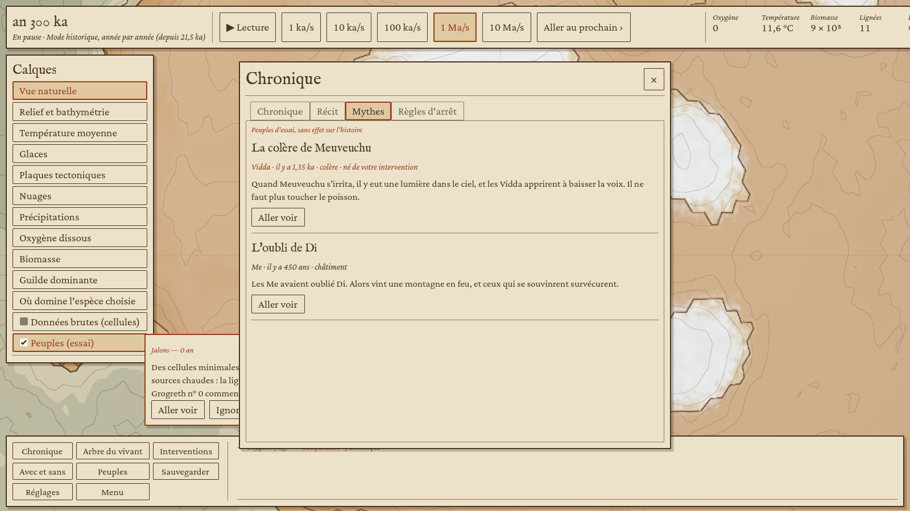
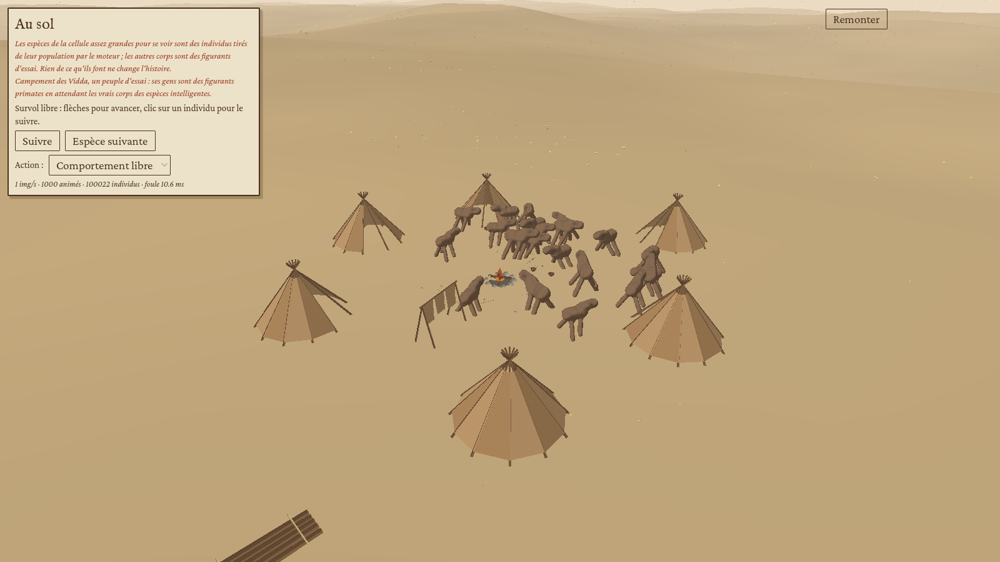
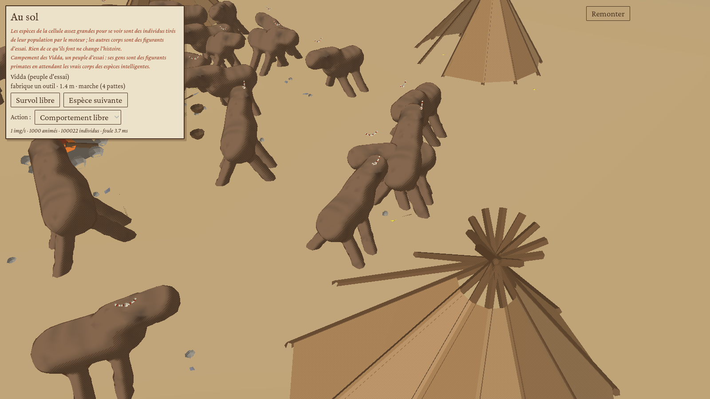

# Étape 6, côté client : les peuples à l'écran (sur peuples d'essai)

Affichage de l'étape 6 selon le « Périmètre consolidé de l'étape 6 » du doc d'architecture : les peuples sur le globe (G5), les fiches de peuple et de personnage, l'arbre des cultures, l'onglet des mythes, le mode historique dans la barre du temps, et la première part du palier 3 du rendu (outils, abris, campements, parures, gestes des quatre actions culturelles). Les bâtiments et les villes restent à l'étape 7.

## Peuples d'essai

Le moteur ne fait pas encore naître de peuples. En attendant, le client pose des **peuples d'essai** sur les terres de la partie (`evo_view::culture::bench_world`, bibliothèque `evo-culture`) : un hominidé d'essai sur 160 cellules habitables, un grand singe d'essai sur 36 cellules voisines, 40 000 ans à grands pas puis 1 500 ans année par année, une île coupée puis reliée, une lumière dans le ciel (intervention) et une éruption pour faire naître des mythes. Le calcul tourne en tâche de fond (1,3 s au niveau 6) et ne touche jamais l'histoire de la partie. L'écran le dit partout où ces peuples paraissent (calque, fenêtre, fiches, mythes, scène au sol).

Quand le moteur publiera l'état culturel, il suffira de remplacer la source de `CultureSlot` (`evo-godot/src/session/culture.rs`) : tout le reste lit le format `CulturalState`.

## Ce que voit le joueur

| Capture | Ce qu'on y voit |
|---|---|
|  | Calque « Peuples (essai) » : territoires en lavis à la couleur du peuple, plus dense là où il est nombreux, liseré des cartes anciennes et frontière à l'encre ; noms des peuples en capitales. |
|  | L'inspecteur dit le peuple de la cellule (effectif, techniques) et ouvre sa fiche ; la barre du temps dit le mode historique. |
|  | Fenêtre « Peuples » (touche P) : la liste, l'arbre des peuples, l'arbre des langues, les personnages. |
|  | Arbre des peuples : un peuple qui essaime garde sa ligne au-dessus de ses descendants. |
|  | Fiche de peuple : résumé, origine et descendants, langue et quelques mots, techniques (part et maîtrise), coutumes, mythes, personnages. |
|  | Fiche de personnage : inventeur ou passeur, ce qu'il a apporté, sa vie en deux phrases. |
|  | Onglet « Mythes » de la chronique ; ceux nés d'une intervention du joueur le disent. |
|  | Descente au sol sur le cœur d'un peuple : foyer, huttes (ou pare-vent sans la technique des abris), séchoir, radeau, outils posés, et ses gens. |
|  | Les gens fabriquent leurs outils au bord du feu, enseignent et échangent face à face, dansent en rond pendant les rites, l'épieu à l'épaule en marchant, le collier au cou. |

## Comment

- `evo_view::culture` : peuples d'essai, texture des territoires, étiquettes, fiches, arbres, mythes, ligne de l'inspecteur et du mode, vue d'un campement.
- `evo_view::tree::build_keeping_parents` : variante de l'arbre où un parent vivant garde sa propre ligne (l'arbre du vivant ne change pas).
- `evo_morph::artefact` : seize objets en facettes (hutte, pare-vent, foyer, séchoir, percuteur, éclat, biface, épieu, bâton, corde, contenant, collier, radeau, poinçon, nasse, propulseur), chacun tiré de sa graine, aux couleurs des matières.
- `evo_view::camp` : un objet par technique portée par plus d'un quart du groupe, campement posé sur le replat le plus doux, parts des quatre actions culturelles ; `Crowd::add_camp` et `Crowd::props` pour les gens et ce qu'ils tiennent.
- Son : la scène au sol passe au fil Design sonore la langue et les rites du peuple (`EvoSon.peuple`), et lance un chant quand trois gens ou plus dansent autour du feu.

## Limites connues

- [Simplification] Les gens du campement sont des figurants primates à quatre membres, en attendant les vrais corps des espèces intelligentes (fil Animaux). Un outil tenu est posé au sol devant la tête pendant le geste, puisqu'il n'y a pas encore de main.
- Les peuples d'essai vivent sur une planète qui peut être gelée ou sans oxygène : ils montrent l'affichage, pas une histoire plausible.
- Les frontières suivent les cellules de la grille, d'où des bords en dents de scie au zoom continental.

## Essai

```sh
godot --path client --resolution 1600x900 -- --porte4 --seul=peuples --sortie=/tmp/peuples
```

Dernier passage (Terre, graine 2026, niveau 4) : 3 peuples (Vidda, Paisapé, Me), mode historique, 12 techniques et 5 personnages chez Vidda, 2 mythes dont un né de l'intervention ; au sol, 23 objets posés, 21 gens et 32 objets tenus ou portés. Le job `client-linux` joue ce scénario.
