# Étape 7, côté client : les sociétés à l'écran (sur sociétés d'essai)

Affichage de l'étape 7 selon le périmètre de l'étape 7 du doc d'architecture et les docs Fonctionnalités d'interface, Globe 3D et Rendu du vivant : sociétés sur le globe (territoires, champs, villes, routes d'échange, lumières de nuit), fiche de société, comparaison de civilisations, chronique et récit d'une période, bilan pour la planète, encyclopédie avec le tableau des simplifications assumées. Le format lu est `evo_society::state::SocietyState` v1 (bibliothèque `evo-society`). Les bâtiments et les villes au sol (palier 3b du rendu) et la galerie de rejeux viendront dans une seconde PR.

## Sociétés d'essai

Le moteur ne fait pas encore naître de sociétés. En attendant, le client pose des **sociétés d'essai** sur les terres de la partie (`evo_view::society::bench_world`) :

- une région d'au plus 700 terres habitables d'un seul tenant, autour du cœur des peuples d'essai de l'étape 6 (ou de la terre la plus douce) ;
- quatorze espèces sauvages autour de foyers où le climat leur va, d'où des foyers agricoles distincts ;
- des chasseurs-cueilleurs du Paléolithique supérieur, qui vivent de −12 000 à 2100 année par année.

Le calcul tourne en tâche de fond, au plus 250 ans par seconde, et publie un état toutes les 20 années. Il ne touche jamais l'histoire de la partie. L'écran le dit partout où ces sociétés paraissent : calque, fenêtres, fiches et comparaison.

Quand le moteur publiera l'état des sociétés, il suffira de remplacer la source de `SocietySlot` (`evo-godot/src/session/society.rs`) : tout le reste lit le format `SocietyState`.

## Ce que voit le joueur

| Capture | Ce qu'on y voit |
|---|---|
| 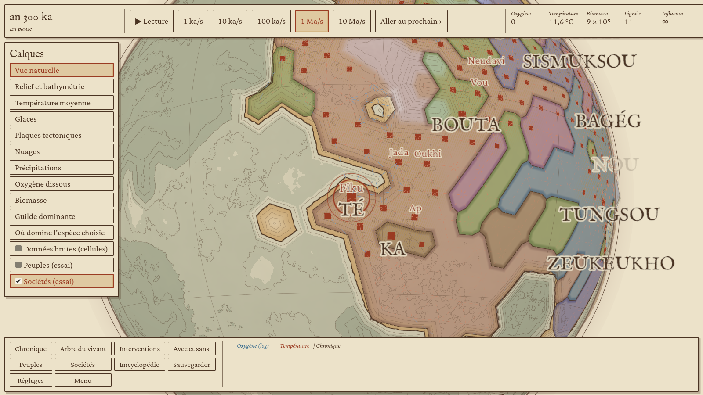 | Calque « Sociétés (essai) » : territoires en lavis à la couleur de la société, frontières à l'encre. Les champs sont en sillons ocre, plus marqués où la terre est labourée. Les villes sont des carrés vermillon (la capitale plus grande), les noms des sociétés en capitales et ceux des villes au vermillon ; un nom qui en chevaucherait un plus important se tait. |
| 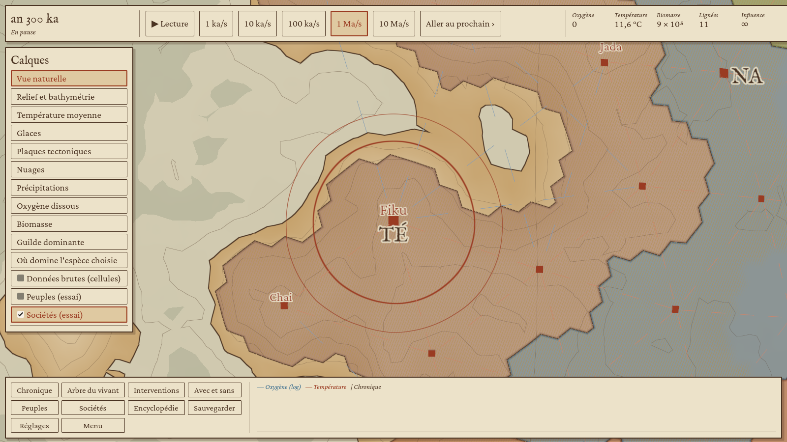 | De plus près : les routes d'échange en pointillés, vermillon sur terre et bleu de Prusse en mer, plus nettes où l'on échange beaucoup. |
| 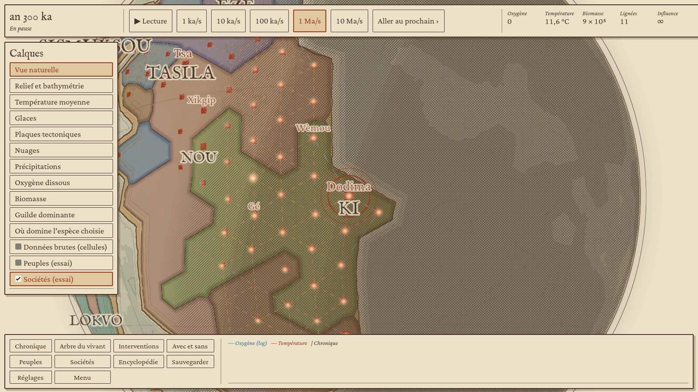 | Avec le terminateur (réglages), les villes s'allument côté nuit, d'autant plus que la cellule est dense. |
| 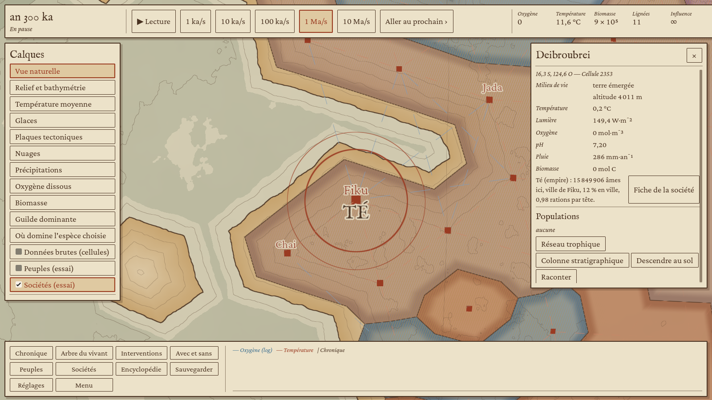 | L'inspecteur donne la société de la cellule (âmes, ville, part urbaine, rations par tête) et ouvre sa fiche. |
| 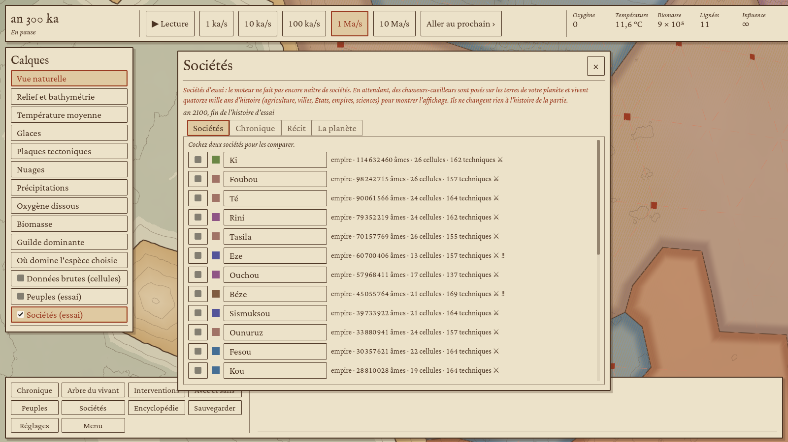 | Fenêtre « Sociétés » (touche S) : la liste avec sa forme, sa population, ses cellules et ses techniques (⚔ en guerre, ‼ en crise). Cocher deux sociétés ouvre la comparaison. |
| 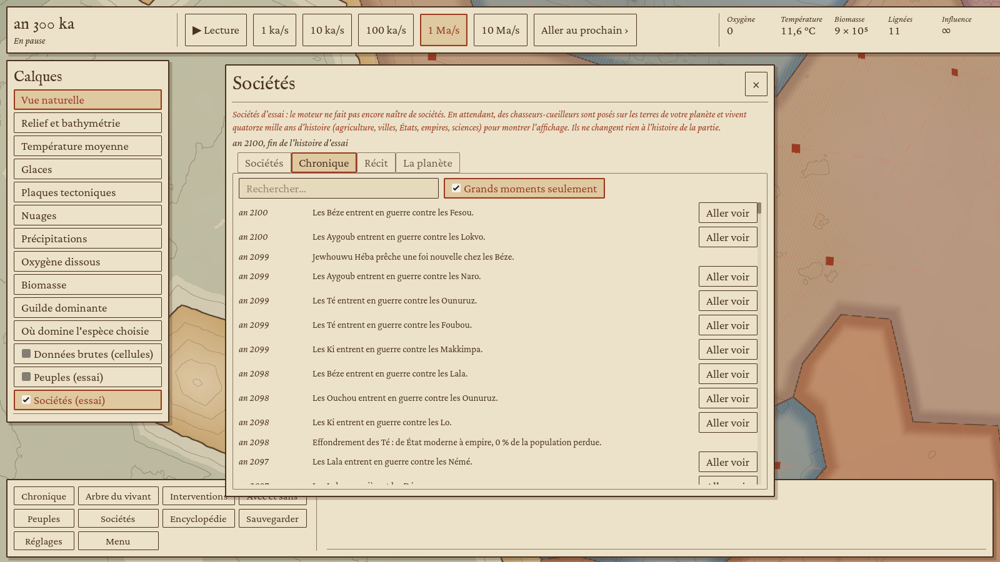 | Chronique des sociétés, avec recherche et filtre des grands moments ; « Aller voir » pose le globe sur le lieu. |
| 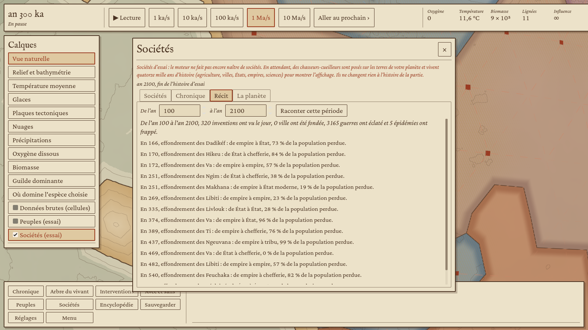 | Récit d'une période, écrit comme un chapitre d'histoire : le bilan, puis les grands moments. |
| 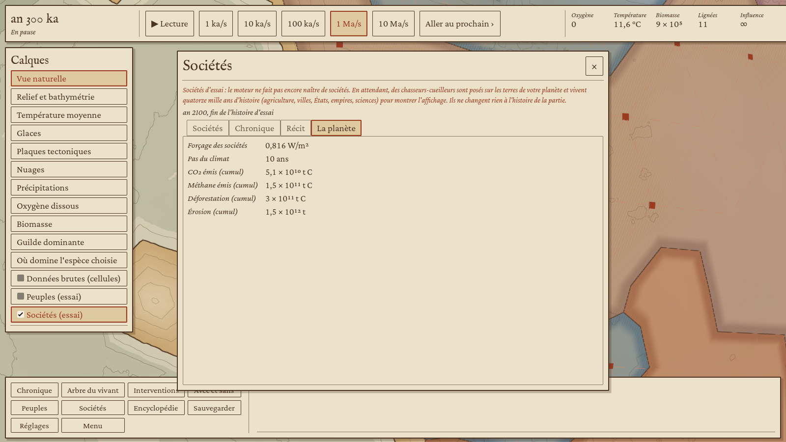 | Ce que les sociétés rendent à la planète : forçage du climat, CO₂ et méthane émis, déforestation, érosion. |
| 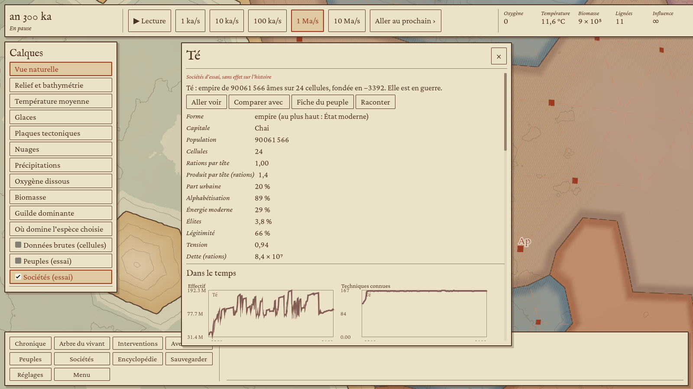 | Fiche de société : résumé, forme et rang le plus haut, grandeurs agrégées, courbes dans le temps. |
| 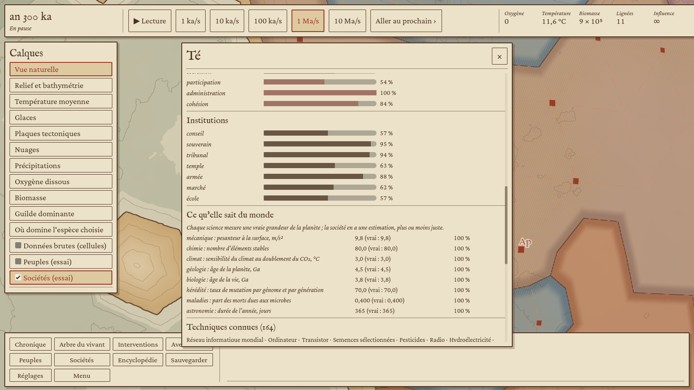 | Puis les six dimensions et les sept institutions en jauges, et ce qu'elle sait du monde : chaque science mesure une vraie grandeur, avec l'estimation de la société à côté de la vraie valeur. Viennent ensuite les techniques (les plus avancées d'abord, avec leur équivalent terrestre au survol), les relations, les villes et les personnages. |
| 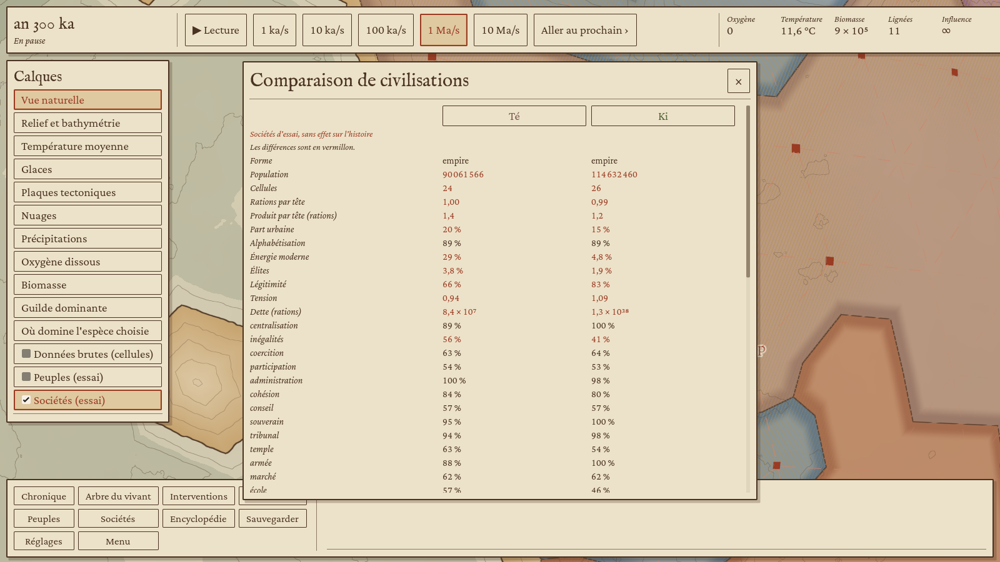 | Comparaison de civilisations : deux sociétés trait par trait, avec les différences en vermillon, puis six courbes sur un même axe des années. |
| 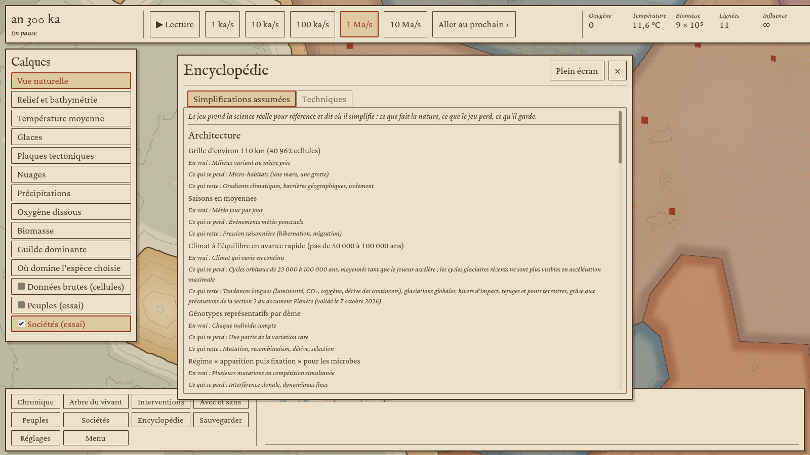 | Encyclopédie (touche E) : le tableau des simplifications assumées, par doc (ce que fait la nature, ce qui se perd, ce qui reste). |
| 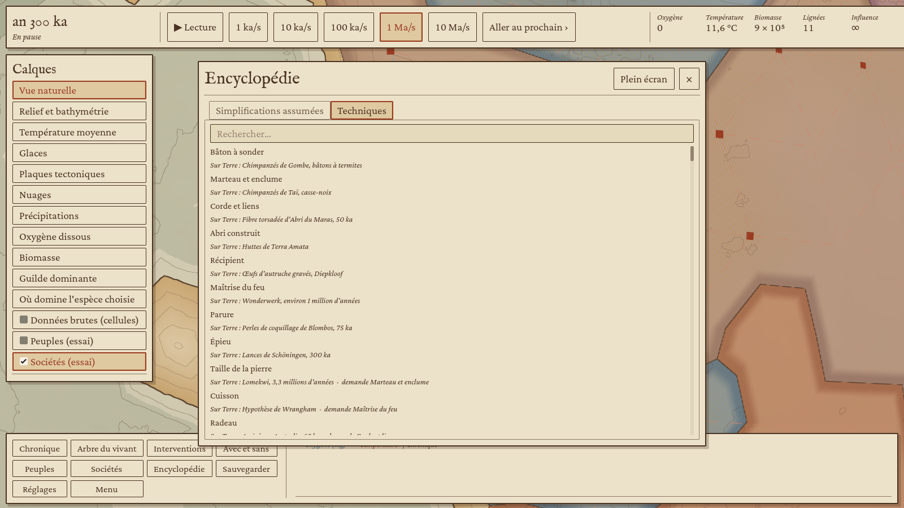 | Le catalogue des techniques, avec leur équivalent sur Terre et ce qu'elles demandent. |

## Comment

- `evo_view::society` : sociétés d'essai, historique échantillonné (courbes), texture des territoires et des champs, noms, villes, routes, lumières, fiche, comparaison, chronique, récit, bilan pour la planète, catalogue des techniques.
- `evo_view::encyclopedia` : le tableau des simplifications assumées, recopié des docs de conception (architecture, organismes, intelligence et sociétés), plus celles du client.
- `evo-godot/src/session/society.rs` : le fil de calcul des sociétés d'essai et les fonctions lues par le client.
- Globe : les territoires et les champs passent par la texture des peuples (`data5`) ; la palette des peuples passe à neuf couleurs pour libérer une variable du shader du globe (il est à la limite de 32). Les villes, les routes et les lumières sont dessinées à part (`globe_societes.gd`, `lumieres.gdshader`).

## Limites connues

- [Simplification] Le climat du banc est ramené à celui de la Terre de l'holocène. La géographie est celle de la planète : côtes, latitudes, montagnes relatives, régions plus ou moins arrosées. Sans cela, une planète jeune, gelée ou faite de hauts plateaux ne laisse pas l'histoire d'essai sortir des bandes de chasseurs.
- Les sciences des sociétés d'essai mesurent les grandeurs de la Terre (`Truths::earth()`), pas celles de la planète de la partie.
- Les frontières suivent les cellules de la grille, d'où des bords en dents de scie au zoom continental.
- Les textes d'événements viennent d'`evo-society` ; quelques bizarreries ont été signalées au fil Individus (dette publique qui s'emballe, effondrements sans perte de rang). En attendant, la dette n'est affichée qu'à partir de l'État.
- Le tableau des simplifications n'existe qu'en français.

## Essai

```sh
godot --path client --resolution 1600x900 -- --porte4 --seul=societes --an=1000 --sortie=/tmp/societes
```

Dernier passage (Terre, graine 2026, niveau 4, planète à 200 ka) : 353 terres, puis à l'an 1100 19 sociétés (la plus peuplée, Ki, est un empire de 115 millions d'âmes) et 198 villes. De −12 000 à 2100, on compte 2 328 inventions et 228 villes fondées. Le job `client-linux` joue ce scénario jusqu'à l'an −6000.
