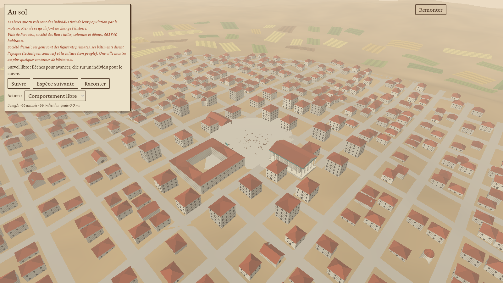
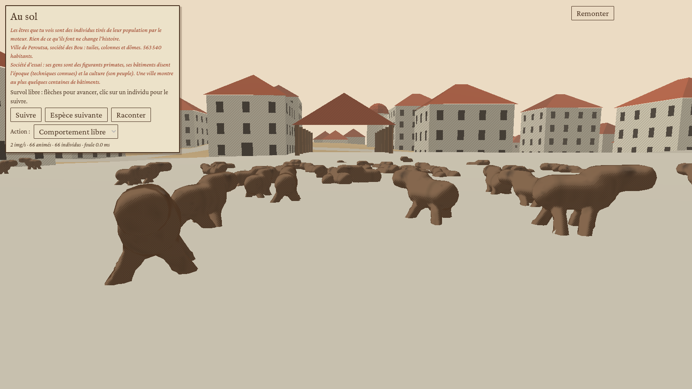
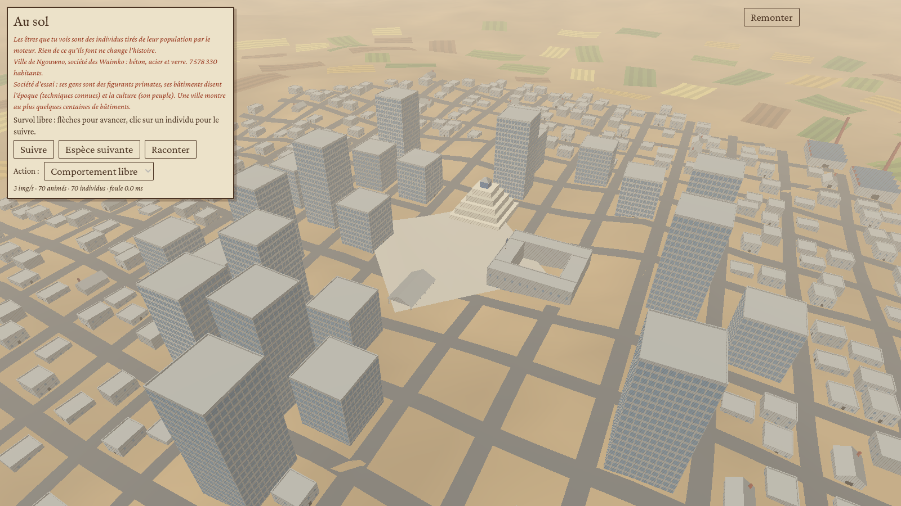
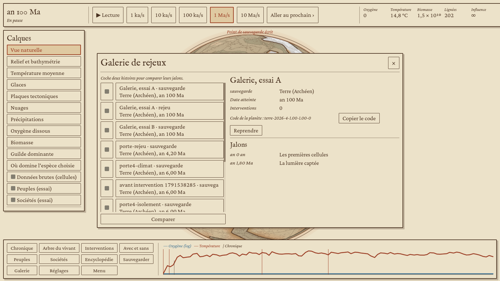
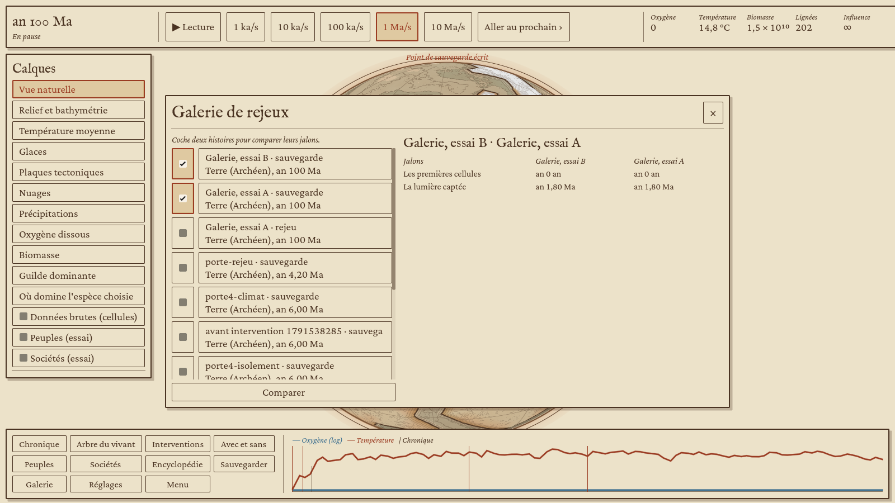

# Étape 7, côté client : les sociétés à l'écran (sur sociétés d'essai)

Affichage de l'étape 7 selon le périmètre de l'étape 7 du doc d'architecture et les docs Fonctionnalités d'interface, Globe 3D et Rendu du vivant : sociétés sur le globe (territoires, champs, villes, routes d'échange, lumières de nuit), fiche de société, comparaison de civilisations, chronique et récit d'une période, bilan pour la planète, encyclopédie avec le tableau des simplifications assumées. Le format lu est `evo_society::state::SocietyState` v1 (bibliothèque `evo-society`). S'y ajoutent les bâtiments et les villes au sol (palier 3b du document Rendu du vivant) et la galerie de rejeux (document Fonctionnalités).

## Sociétés d'essai

Le moteur ne fait pas encore naître de sociétés. En attendant, le client pose des **sociétés d'essai** sur les terres de la partie (`evo_view::society::bench_world`) :

- une région d'au plus 700 terres habitables d'un seul tenant, autour du cœur des peuples d'essai de l'étape 6 (ou de la terre la plus douce) ;
- quatorze espèces sauvages autour de foyers où le climat leur va, d'où des foyers agricoles distincts ;
- des chasseurs-cueilleurs du Paléolithique supérieur, qui vivent de −12 000 à 2100 année par année.

Le calcul tourne en tâche de fond, au plus 250 ans par seconde, et publie un état toutes les 20 années. Il ne touche jamais l'histoire de la partie. L'écran le dit partout où ces sociétés paraissent : calque, fenêtres, fiches et comparaison.

Quand le moteur publiera l'état des sociétés, il suffira de remplacer la source de `SocietySlot` (`evo-godot/src/session/society.rs`) : tout le reste lit le format `SocietyState`.

## Ce que voit le joueur

| Capture | Ce qu'on y voit |
|---|---|
|  | Calque « Sociétés (essai) » : territoires en lavis à la couleur de la société, frontières à l'encre. Les champs sont en sillons ocre, plus marqués où la terre est labourée. Les villes sont des carrés vermillon (la capitale plus grande), les noms des sociétés en capitales et ceux des villes au vermillon ; un nom qui en chevaucherait un plus important se tait. |
|  | De plus près : les routes d'échange en pointillés, vermillon sur terre et bleu de Prusse en mer, plus nettes où l'on échange beaucoup. |
|  | Avec le terminateur (réglages), les villes s'allument côté nuit, d'autant plus que la cellule est dense. |
|  | L'inspecteur donne la société de la cellule (âmes, ville, part urbaine, rations par tête) et ouvre sa fiche. |
|  | Fenêtre « Sociétés » (touche S) : la liste avec sa forme, sa population, ses cellules et ses techniques (⚔ en guerre, ‼ en crise). Cocher deux sociétés ouvre la comparaison. |
|  | Chronique des sociétés, avec recherche et filtre des grands moments ; « Aller voir » pose le globe sur le lieu. |
|  | Récit d'une période, écrit comme un chapitre d'histoire : le bilan, puis les grands moments. |
|  | Ce que les sociétés rendent à la planète : forçage du climat, CO₂ et méthane émis, déforestation, érosion. |
|  | Fiche de société : résumé, forme et rang le plus haut, grandeurs agrégées, courbes dans le temps. |
|  | Puis les six dimensions et les sept institutions en jauges, et ce qu'elle sait du monde : chaque science mesure une vraie grandeur, avec l'estimation de la société à côté de la vraie valeur. Viennent ensuite les techniques (les plus avancées d'abord, avec leur équivalent terrestre au survol), les relations, les villes et les personnages. |
|  | Comparaison de civilisations : deux sociétés trait par trait, avec les différences en vermillon, puis six courbes sur un même axe des années. |
|  | Encyclopédie (touche E) : le tableau des simplifications assumées, par doc (ce que fait la nature, ce qui se perd, ce qui reste). |
|  | Le catalogue des techniques, avec leur équivalent sur Terre et ce qu'elles demandent. |

## Villes au sol

Descendre au sol sur une cellule qui a une ville, ou des cultivateurs sédentaires, montre cette ville ou un de ses villages à la place du campement de l'étape 6 :

- une place au centre, avec le temple, le palais d'une capitale ou d'un État, et la halle quand la société connaît la monnaie ;
- des rues en étoile, qui s'arrêtent aux monuments, ou un damier quand la société connaît l'urbanisme ;
- des maisons le long des rues, des immeubles au cœur des villes denses, des ateliers, et des usines en lisière à l'ère de la vapeur ;
- un rempart et ses tours si la société connaît les fortifications (jusqu'à l'ère de la vapeur), ouvert là où passent les rues ;
- des greniers, des moulins sur les hauteurs, et des champs en lanières autour quand la cellule cultive ;
- des ruines quand la ville est tombée sous la moitié de sa population la plus haute : le plan de sa grandeur reste, les maisons en trop sont sans toit ;
- ses gens, des figurants primates qui vont et viennent sur la place.

Les bâtiments sortent d'une grammaire de formes (`evo_morph::building`). Les techniques connues de la cellule fixent l'époque : bois et chaume, brique crue, pierre de taille, tuiles, colonnes et dômes, brique et vapeur, puis béton, acier et verre. Le peuple de la société fixe le style : forme des toits (deux pentes, croupe, terrasse, étagés), forme du temple (gradins, colonnade, pagode, dôme), huttes rondes ou carrées, teintes. Une culture garde son allure d'une époque à l'autre, et deux sociétés de peuples différents ne se ressemblent pas.

| Capture | Ce qu'on y voit |
|---|---|
|  | Une ville de l'an −4000 : tuiles, colonnes et dômes, rues en étoile, champs en lanières. |
|  | La même, depuis la place : ses gens (figurants), les maisons à étages et le temple à colonnade. |
|  | Une ville moderne des sociétés d'essai : immeubles au centre, usines en lisière. |

## Galerie de rejeux

La galerie (touche G en partie, ou depuis l'accueil) range les sauvegardes et les rejeux, du plus récent au plus ancien. Pour chacun, elle donne la planète, la date atteinte, les interventions, le code de planète à copier et les jalons de son histoire, c'est-à-dire le début de chaque chapitre du récit.

- **Exporter un rejeu** : bouton de la fenêtre « Sauvegarder ». Le fichier `.rejeu` garde le code de planète, l'ensemencement, le mode et le registre des ordres (sans les pauses ni les reprises, qui ne changent pas l'histoire). Il tient en quelques kilo-octets et se partage.
- **Rejouer** : une partie neuve sur la même planète, avec les mêmes ordres à leur date, qui se met en pause là où le rejeu s'arrêtait. Un bandeau le rappelle.
- **Reprendre** une sauvegarde, comme « Charger ».
- **Comparer** : cocher deux histoires montre leurs jalons côte à côte, avec en vermillon ceux qui diffèrent.

Les fiches des sauvegardes gardent maintenant leurs jalons (lignes `jalon`, ignorées par les versions précédentes).

| Capture | Ce qu'on y voit |
|---|---|
|  | La galerie, ouverte en partie sur le rejeu exporté : planète, code, jalons. |
|  | Une partie et son rejeu, sauvegardés tous deux à 100 Ma, comparés : mêmes jalons aux mêmes dates. |

## Comment

- `evo_view::society` : sociétés d'essai, historique échantillonné (courbes), texture des territoires et des champs, noms, villes, routes, lumières, fiche, comparaison, chronique, récit, bilan pour la planète, catalogue des techniques.
- `evo_view::encyclopedia` : le tableau des simplifications assumées, recopié des docs de conception (architecture, organismes, intelligence et sociétés), plus celles du client.
- `evo-godot/src/session/society.rs` : le fil de calcul des sociétés d'essai et les fonctions lues par le client.
- `evo_morph::building` : la grammaire des bâtiments (douze sortes, six époques, styles par culture). `evo_view::town` : la ville d'une cellule (plan, rues, monuments, maisons, rempart, champs, ruines) et son sol drapé sur le relief ; la scène au sol (`EvoGround.town_*`) la dessine avec un `MultiMesh` par modèle.
- `evo_view::save::ReplayFile` et `evo-godot/src/session/gallery.rs` : export, lecture et relecture des rejeux, jalons des fiches ; `client/scripts/ui/galerie.gd` : la fenêtre.
- Globe : les territoires et les champs passent par la texture des peuples (`data5`) ; la palette des peuples passe à neuf couleurs pour libérer une variable du shader du globe (il est à la limite de 32). Les villes, les routes et les lumières sont dessinées à part (`globe_societes.gd`, `lumieres.gdshader`).

## Limites connues

- [Simplification] Le climat du banc est ramené à celui de la Terre de l'holocène. La géographie est celle de la planète : côtes, latitudes, montagnes relatives, régions plus ou moins arrosées. Sans cela, une planète jeune, gelée ou faite de hauts plateaux ne laisse pas l'histoire d'essai sortir des bandes de chasseurs.
- Les sciences des sociétés d'essai mesurent les grandeurs de la Terre (`Truths::earth()`), pas celles de la planète de la partie.
- Les frontières suivent les cellules de la grille, d'où des bords en dents de scie au zoom continental.
- Les textes d'événements viennent d'`evo-society`. Les correctifs de sa PR #44 (dette bornée, effondrements, chronique) sont repris : la dette s'affiche dès qu'elle existe.
- Les sociétés d'essai, parties de −12 000, inventent vite : leurs villes ont des tuiles et des dômes dès −4000 et des immeubles avant l'an 1000. Les villes au sol suivent fidèlement ces techniques.
- [Simplification] Une ville montre au plus quelques centaines de bâtiments (520 instances), plus nombreux quand elle est grande ; son plan ne vient pas d'une histoire des rues.
- Le rejeu refait l'histoire depuis la graine : il demande le temps de la refaire. Les jalons sont écrits dans la langue de l'écran au moment de la sauvegarde.
- Le tableau des simplifications n'existe qu'en français.

## Essai

```sh
godot --path client --resolution 1600x900 -- --porte4 --seul=societes --an=1000 --sortie=/tmp/societes
godot --path client --resolution 1600x900 -- --porte4 --seul=ville --ans=-4000,800,1950 --sortie=/tmp/ville
godot --path client --resolution 1600x900 -- --porte4 --seul=galerie --ma=100 --sortie=/tmp/galerie
```

Le scénario `ville` descend dans la plus grande ville à chaque année donnée. Le scénario `galerie` sauvegarde une partie, l'exporte en rejeu, la rejoue depuis la graine jusqu'à la même date et vérifie que les jalons sont les mêmes. Le job `client-linux` joue les deux (ville de l'an −6000, galerie à 100 Ma).

Dernier passage, avec les correctifs d'evo-society de la PR #44 (Terre, graine 2026, niveau 4, planète à 200 ka) : à l'an 1120, 21 sociétés (la plus peuplée, Waimko, est un empire) et 170 villes. Le job `client-linux` joue ce scénario jusqu'à l'an −6000.
